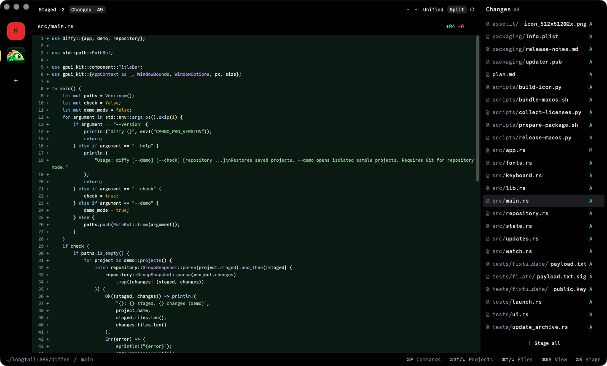

#  Diffy

[Download the latest version for macOS](https://github.com/hitSlop/diffy/releases/latest) · Apple Silicon · macOS 13+



A small native Rust/GPUI Kit diff viewer for macOS.

- Pure-black surfaces and colored squircle project icons that grow gently on hover. Badges count unique changed files across Staged and Changes (partially staged files count once).
- Bundled Commit Mono Regular and Medium throughout the app, with programming ligatures disabled.
- A compact alphabetical file list with aligned paths and subtle spacing between directories on the right and one selected diff in the center. Filenames stay prominent; directory prefixes are dimmed and shortened in the middle when needed. Hover shows the complete path.
- **Staged** first, then **Changes**, with separate counts. Changes is selected initially.
- Staged compares HEAD with the index; Changes compares the index with disk and includes untracked files. A file can appear in both views.
- Unified or split diffs with highlighting, inline changes, expandable context, source selection, and copying. Long lines wrap; split mode gives 40% to the original and 60% to the modified source. Added files fill one pane.
- Hover **+ / −** actions in file rows and the preview header for whole-file staging/unstaging. Row actions affect that row without selecting it.
- Sticky **Stage all / Unstage all** below the file list runs one Git operation for the current scope; it is also available in the command palette.
- A searchable **⌘P** palette for switching projects and executing commands.
- Opened repositories, their order, active project, scopes, diff modes, selected files, custom names, icons, and sidebar width are remembered across launches. Drag the sidebar divider to resize it; the handle appears on hover.
- Right-click a project for settings: rename it, change its color with GPUI Kit's color picker, enter an emoji (⌃⌘Space opens the macOS picker), choose an image, or remove it from Diffy. Image icons reference the chosen local file; unavailable images fall back to the project initial. Images use rounded square crops and stay fixed in size during hover.
- Removing from Diffy only removes the saved entry. It never deletes a project or changes its Git state.
- Holding ⌘↑/↓ advances through files at approximately five per second after a brief initial delay; individual taps stay immediate. macOS holds use a timer and physical key-state checks, independent of OS shortcut autorepeat. Navigation preferences save after a short idle debounce.
- Drag the unused toolbar area to move the window. A short repository path and branch sit on the left of the footer, with keyboard hints on the right; no app title, change description, commit, approval, or messaging controls.

## Run

Requires Rust and Xcode Command Line Tools. Git must be on PATH for repository mode.

```sh
cargo run --locked
cargo run --locked -- /path/to/repository /path/to/another/repository
cargo run --locked -- --demo
```

Normal launch restores repositories; first launch shows an Open repository prompt. Use **+**, **⌘O**, or the command palette to open repositories. Nested folders resolve to their Git root and duplicate roots are merged. Missing repositories remain removable and show a recoverable error.

`--demo` opens sample projects without reading or writing saved preferences. Demo staging is disabled.

## Terminal command

In the installed macOS app, choose **File → Install terminal command…**, or search for **Install terminal command** in the command palette. This installs `~/.local/bin/diffy` for your user. Existing commands from other tools are preserved.

If your terminal cannot find it, add this line to your shell configuration (usually `~/.zshrc`) and open a new terminal:

```sh
export PATH="$HOME/.local/bin:$PATH"
```

```sh
diffy .
diffy /path/to/repository /path/to/another/repository
diffy --check .
diffy --version
```

`diffy .` adds or selects the repository in the existing Diffy window and brings it forward. A closed window is recreated; a stopped app is launched. Relative paths are resolved in your terminal, and nested folders resolve to the repository root. `diffy` without paths opens your saved projects. Reinstall the command if you move `Diffy.app`; normal updates at the same location keep it working.

CLI installation is currently macOS-only. Development binaries still accept repository paths directly through `cargo run`.

## Keyboard shortcuts

| Shortcut | Action |
|---|---|
| ⌘P | Search projects and commands |
| ⌘O | Open repositories |
| ⌘⇧↓ / ⌘⇧↑ | Next / previous project |
| ⌘↓ / ⌘↑ | Next / previous file |
| ⌘⇧S | Toggle Staged / Changes |
| ⌘S | Stage file in Changes; unstage file in Staged |
| ⌘R | Refresh repository |
| ⌥↓ / ⌥↑ | Next / previous change |
| ⌘Enter | Focus the diff |
| ⌘C | Copy selected source |
| Arrow keys | Navigate the focused file list, palette, or diff |
| ⌘Q | Quit |

In the palette, Enter executes; Escape clears a nonempty query, then closes. Clicking outside dismisses it.

Each project remembers its scope; each scope retains its selection and viewport during the session. When staging removes the selected file, Diffy selects the next remaining file, with a previous-file fallback at the end. Background operations retain user navigation where possible and block duplicate writes.

Git writes affect the selected file's index entries only. Unstaging preserves working-tree contents, including on unborn branches. Rename actions include both paths; copy actions affect the destination only. Errors retain the last good preview.

Preferences live at `~/Library/Application Support/Diffy/state.json` and contain paths and viewer settings, never patches or source contents. Tests inject temporary storage; `DIFFY_STATE_PATH` can override the path for isolated development sessions.

## Build a macOS app

```sh
./scripts/bundle-macos.sh
open dist/Diffy.app
```

The default bundle uses a development build; `--release` builds an optimized app. The bundle is locally ad-hoc signed.

## Verify

```sh
cargo test --locked
cargo clippy --locked --features ui-tests --all-targets -- -D warnings
cargo run --locked -- --check
cargo run --locked -- --check /path/to/repository
cargo test --locked --features ui-tests --test ui
```

Git tests run in disposable repositories and cover independent scopes, index preservation during reads, literal filenames, renames, deletions, copies, unborn HEAD, binary additions, and index-lock failures. Preference tests cover atomic saves, restoration, invalid state, and removal without changing repository files. Native UI tests exercise the actual offscreen Metal renderer, palette commands, hover actions, staging shortcuts, reduced motion, restoration, empty states, large-file scrolling, and automatic edit/index detection; PNG previews go to `target/previews`.

Repositories refresh automatically after file and Git metadata changes, with a short debounce. Linked worktree metadata is watched too; ⌘R remains available. Background edits preserve the visible source-line anchor when it still exists, and unrelated file changes retain the current preview. Diff panes are bounded, and overflow scrollbars stay visible. A narrow GPUI Component patch fixes offscreen row estimates for large-file scrolling; see [vendor/README.md](vendor/README.md).

This POC loads full patches in the background. Remote machines, Herdr discovery, advanced diff engines, and exact scroll-position restoration across launches remain later work.

Built with [GPUI Kit](https://gpui-kit.com/) and [Commit Mono](https://commitmono.com/). See [plan.md](plan.md) and [third-party notices](THIRD_PARTY_NOTICES.md).

## macOS release

Diffy uses the bundle identifier `com.hitslop.diffy`. The first release targets Apple Silicon Macs running macOS 13 or later. Source code is MIT licensed; dependency and font licenses remain in effect.

Existing preferences are migrated from `~/Library/Application Support/Differ/state.json` only when no Diffy preferences exist. The original file is retained. `DIFFY_STATE_PATH` takes precedence over the legacy `DIFFER_STATE_PATH` override; explicit overrides skip migration.

Packaged builds check for updates quietly after startup. **Check for Updates…** is also available in the Diffy menu and ⌘P command palette. Updates download and verify only after clicking **Update and Restart**. Git writes finish before installation; projects and preferences survive the restart. Development binaries cannot install updates.

See [RELEASING.md](RELEASING.md) for packaging, local signing, key backups, draft releases, and update verification.
